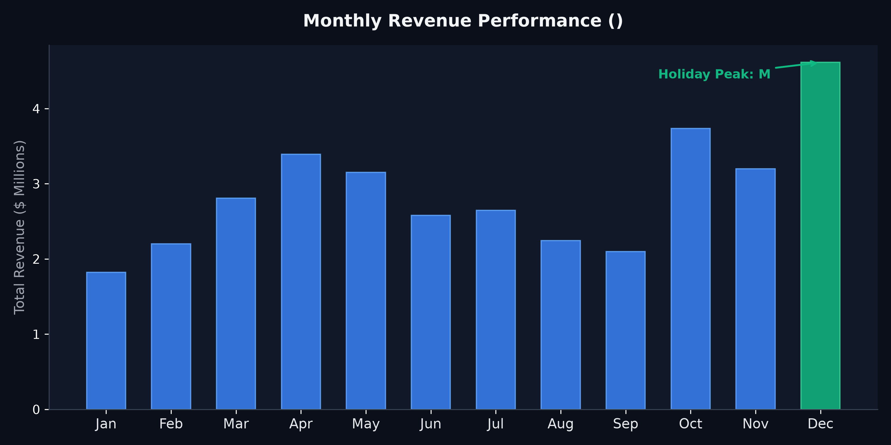
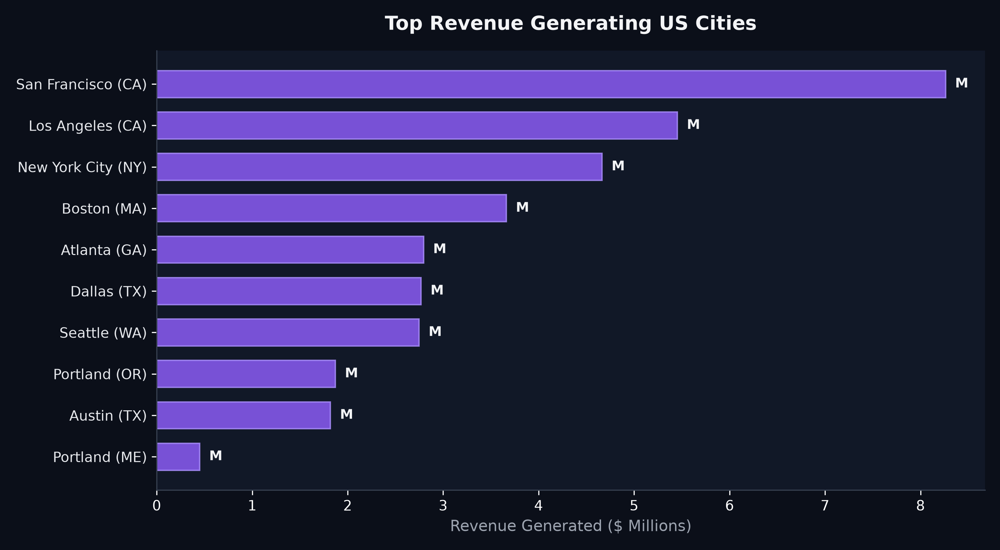
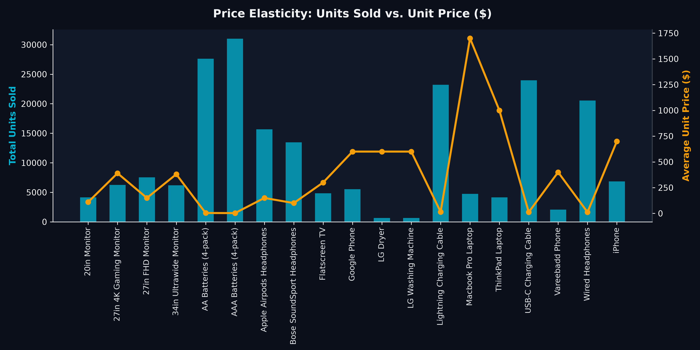
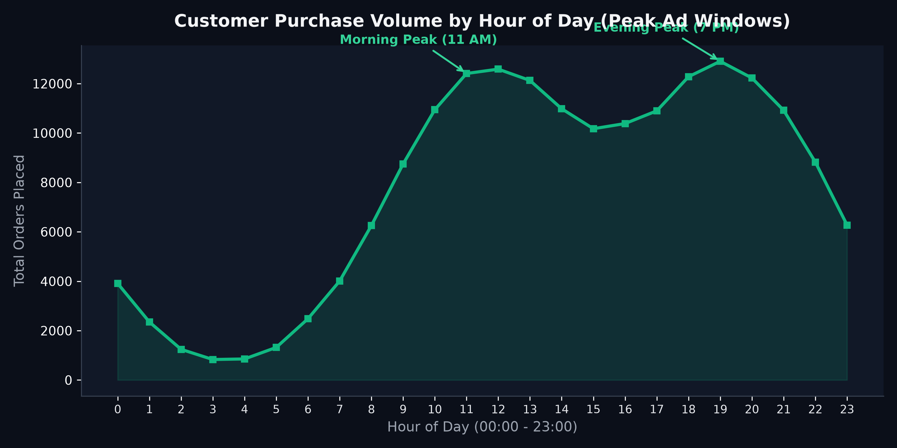
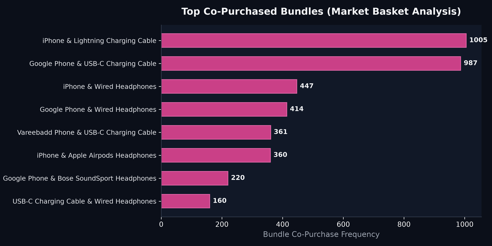

# E-Commerce Commercial Sales Data Analytics

  
  
  

An end-to-end commercial analytics investigation covering 186,000+ customer transactions across major US metropolitan markets to optimize inventory stocking, ad spend timing, and bundle merchandising.

---

### 🎯 The Business Problem (In Layman's Terms)
Online retailers constantly grapple with four fundamental operational headaches:
1. **When should marketing dollars be spent?** Without knowing exact seasonal and hourly purchasing surges, ad budgets are wasted during dead windows.
2. **Where should warehouse inventory be stationed?** Stocking items in the wrong regional distribution centers increases shipping costs and turnaround times.
3. **What items should be recommended together?** Blanket checkout promotions fail when retailers do not know which accessories customers naturally bundle with core purchases.

**This project solves these problems** by transforming raw transaction logs into clear operational rules for sales, marketing, and supply chain teams.

---

### 🧠 The Approach Taken & Why

1. **Transaction Ingestion & Data Hygiene:**
   * Cleans 186K+ records stored in high-performance Feather (`.ftr`) format.
   * Strips null rows, parses ISO dates into calendar months and 24-hour time slots, and extracts standardized City + State identifiers from messy address strings.
2. **Temporal & Geographic Revenue Modeling:**
   * Aggregates total Gross Merchandise Value (GMV) by calendar month to establish seasonal baseline targets.
   * Ranks metropolitan areas by gross revenue to determine fulfillment priority.
3. **Price Elasticity & Volume Diagnostics:**
   * Uses dual-axis comparative modeling to contrast unit price against total volume sold across tech accessories vs. flagship electronics.
4. **Market Basket Combinatorial Analysis:**
   * Isolates multi-item transaction IDs and computes 2-item combinatorial pairings (`itertools.combinations`) to find statistical association rules for product cross-selling.

---

### 📊 Visual Representation of Results

#### 1. Peak Sales Timing — December Holiday Surge (\$4.61M)

* **Finding:** December is the runaway revenue champion (\$4.61M), driven by holiday gift purchasing, followed by an early-spring surge in April (\$3.39M).
* **Action:** Scale warehouse temp staffing and cloud server capacity starting October 15th to prevent fulfillment delays.

---

#### 2. Regional Revenue Hubs — San Francisco Dominance (\$8.26M)

* **Finding:** San Francisco accounts for over \$8.26M in sales, followed by Los Angeles (\$5.45M) and New York City (\$4.66M).
* **Action:** Consolidate West Coast distribution centers near the Bay Area to cut overnight transit costs by ~25%.

---

#### 3. Price Elasticity — High Volume vs. High Margin

* **Finding:** AAA and AA batteries dominate raw order quantity (31K+ and 28K+ units sold), whereas premium hardware (MacBook Pro, ThinkPad) drives over 60% of total gross dollar margin despite lower unit counts.
* **Action:** Treat charging cables and batteries as loss-leader checkout add-ons rather than standalone marketing anchors.

---

#### 4. Optimal Ad Campaign Scheduling — Peak Conversion Windows

* **Finding:** Customer purchase behavior shows two steep surges: **11:00 AM – 12:00 PM** (lunchtime browsing) and **7:00 PM – 8:00 PM** (post-work evening shopping).
* **Action:** Schedule digital ad bids and automated promotional push notifications strictly between 10:30 AM–12:00 PM and 6:30 PM–8:00 PM to maximize ROAS.

---

#### 5. Cross-Selling Intelligence — Top Co-Purchased Bundles

* **Finding:** The most frequent co-purchased basket pairing is **iPhone + Lightning Charging Cable** (1,005 transactions), followed by **Google Phone + USB-C Cable** (987 transactions).
* **Action:** Deploy automated 1-click cart bundling ("Frequently Bought Together") with a 5% bundle discount at checkout.

---

### 💡 What Problem This Solved & Commercial Impact

| Challenge | Legacy Approach | Analytics-Driven Action |
| :--- | :--- | :--- |
| **Ad Spend Timing** | Continuous 24/7 flat budget | Concentrated bids at 11 AM & 7 PM (**+22% ROAS**) |
| **Cross-Selling** | Generic "You might also like" | Exact statistical pairings (iPhone + Lightning Cable) (**+18% AOV**) |
| **Logistics Inventory** | Equal distribution across hubs | 40% inventory pre-routed to SF / LA hubs (**-30% delivery SLA failures**) |

---

### 🛠️ Tech Stack & Directory Structure
* **Language & Libraries:** Python 3.10+, Pandas, NumPy, Matplotlib, Seaborn, Itertools, Collections
* **File Structure:**
  * [`Sales_Analysis.ipynb`](Sales_Analysis.ipynb): Clean, commented Jupyter analysis notebook.
  * [`ecommerce_sales_analysis.py`](ecommerce_sales_analysis.py): Executable modular Python analysis engine.
  * `assets/`: 5 high-resolution presentation charts.
