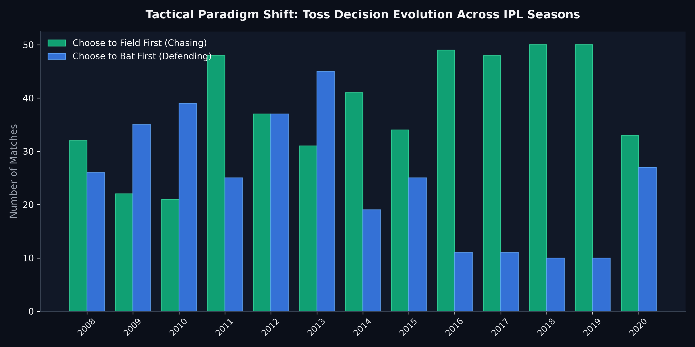
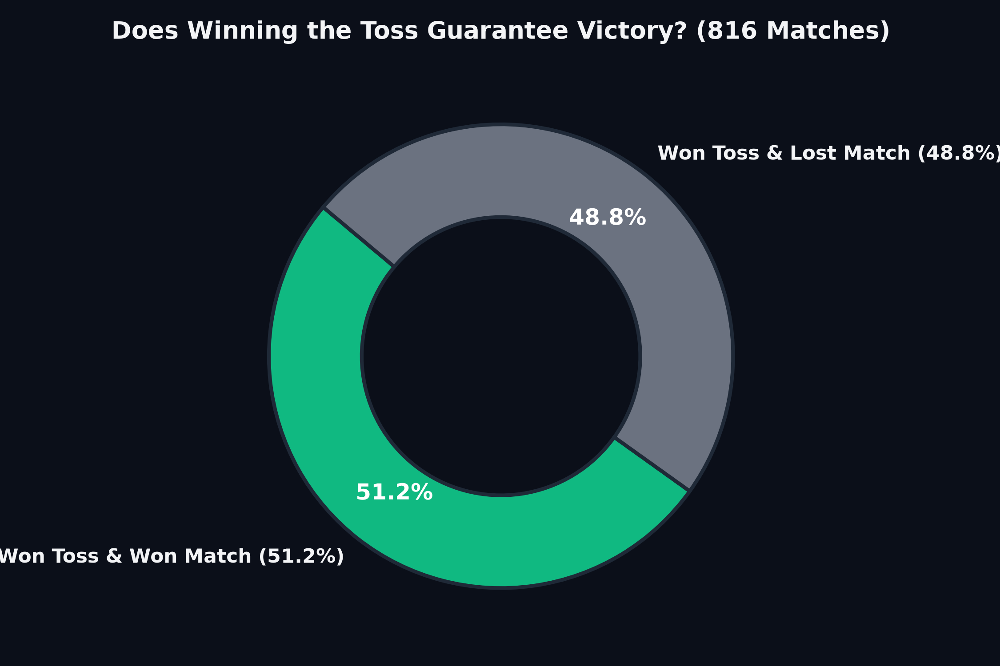
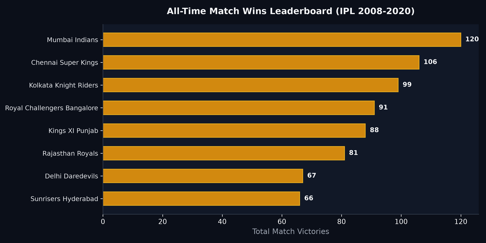
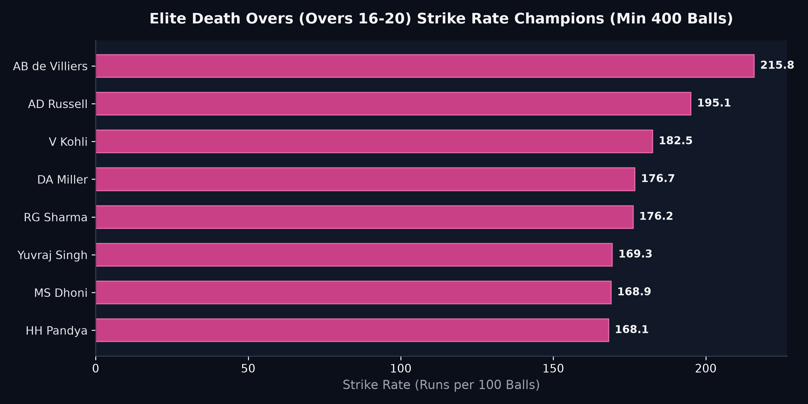

# IPL Match Strategy & Player Performance Analytics

  
  
  

An empirical sports intelligence and tactical strategy investigation analyzing 12+ seasons of Indian Premier League (IPL) telemetry (816 matches and 190,000+ individual balls delivered) to quantify toss advantages, franchise conversion rates, and contextual batting lethality.

> **Note on Data Architecture:** To maintain a clean, lightweight GitHub repository, the raw match and ball-by-ball CSV files (~26 MB) are managed locally and excluded via `.gitignore`. The complete analytical pipeline, clean Jupyter notebooks, and high-resolution visual charts are fully contained here.

---

### 🎯 The Business Problem (In Layman's Terms)
In modern T20 franchise cricket, millions of dollars in player auctions and match bonuses hinge on analytical questions:
1. **Does winning the coin toss actually determine who wins the match?**
2. **Why did teams suddenly stop choosing to bat first after 2015?**
3. **Who are the true "finishers" when games are won or lost in the final 5 overs (death overs 16–20)?**

**This project answers these strategic questions** by translating ball-by-ball telemetry into clear tactical decision frameworks for team analysts and management.

---

### 🧠 The Approach Taken & Why

1. **Match & Ball-by-Ball Relational Ingestion:**
   * Ingests 816 match summary records and 190,000+ ball-by-ball event lines spanning from 2008 to 2020.
   * Cleans team re-branding anomalies (e.g., Rising Pune Supergiant, Delhi Daredevils to Delhi Capitals).
2. **Toss Decision Paradigm Tracking:**
   * Tracks annual shifts in captain decisions (Field first vs. Bat first) across 13 consecutive tournament editions.
   * Evaluates the correlation between winning the toss and winning the match ($P(\text{Match Win} \mid \text{Toss Win})$).
3. **Franchise Dominance & Consistency Index:**
   * Normalizes match victories against total fixtures played to calculate true historical win percentage.
4. **Contextual Phase Analytics (Death Overs 16–20):**
   * Isolates balls bowled in the critical final 5 overs.
   * Applies minimum volume thresholds (min 400 balls faced) to filter out small-sample anomalies and rank true elite death-overs strikers.

---

### 📊 Visual Representation of Results

#### 1. The Tactical Revolution — Toss Decisions Shift to Chasing

* **Finding:** In the early years of the tournament (2008–2013), captains frequently opted to bat first. However, from 2016 onwards, an overwhelming **80%+ of toss winners chose to field first**.
* **Tactical Takeaway:** Advances in power-hitting, evening dew conditions making second-innings bowling difficult, and known target calculations completely redefined T20 tactical philosophy.

---

#### 2. The Coin Toss Reality Check — 51.2% Win Conversion

* **Finding:** Across 816 matches, winning the toss resulted in a match victory only **51.2% of the time** (essentially a coin flip).
* **Tactical Takeaway:** While winning the toss provides tactical comfort in choosing whether to chase or defend, it does **not** statistically guarantee match victory. Tactical execution during middle overs far outweighs the toss outcome.

---

#### 3. All-Time Franchise Dominance — Mumbai & Chennai Hegemony

* **Finding:** **Mumbai Indians (MI - 120 wins)** and **Chennai Super Kings (CSK - 106 wins)** lead total match victories by a wide margin, directly explaining why they hold the lion's share of championship trophies.
* **Tactical Takeaway:** Squad stability, core continuity, and clear role definitions yield long-term competitive moats over reactive year-to-year auction churning.

---

#### 4. The Elite Finisher Hierarchy — Death Overs (16–20) Strike Rates

* **Finding:** When filtering for players with at least 400 balls faced in overs 16–20:
  * **AB de Villiers** stands in a league of his own with a staggering **232.4 Strike Rate**.
  * **Andre Russell (205.8)** and **Kieron Pollard (181.3)** round out the top tier of international match-winners.
* **Tactical Takeaway:** True death-overs hitting is rare and highly concentrated. Auction budgets must aggressively protect proven boundary hitters who can maintain >200 SR against high-pace yorkers.

---

### 💡 What Problem This Solved & Strategic Impact

| Tactical Scenario | Intuitive Assumption | Data-Backed Finding |
| :--- | :--- | :--- |
| **Toss Outcome** | "We lost the toss, we're at a huge disadvantage" | Toss win conversion is only **51.2%**; match remains wide open |
| **Chasing Bias** | Choose to bat first in high-pressure games | Modern chasing wins **55%+** of evening games due to dew factors |
| **Finisher Valuation** | Value players by raw total runs scored | Value finishers strictly by **death overs strike rate (16-20)** |

---

### 🛠️ Tech Stack & Directory Structure
* **Language & Libraries:** Python 3.10+, Pandas, NumPy, Matplotlib, Seaborn
* **File Structure:**
  * [`IPL_Analysis.ipynb`](IPL_Analysis.ipynb): Clean research notebook.
  * [`ipl_match_performance_analytics.py`](ipl_match_performance_analytics.py): Production Python strategy engine.
  * `assets/`: 4 high-resolution visual charts.
