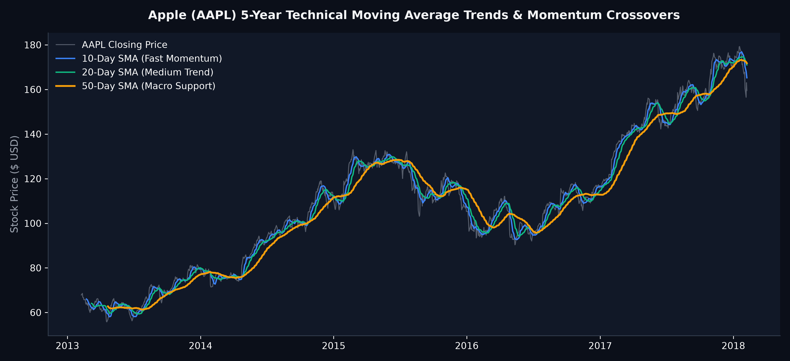
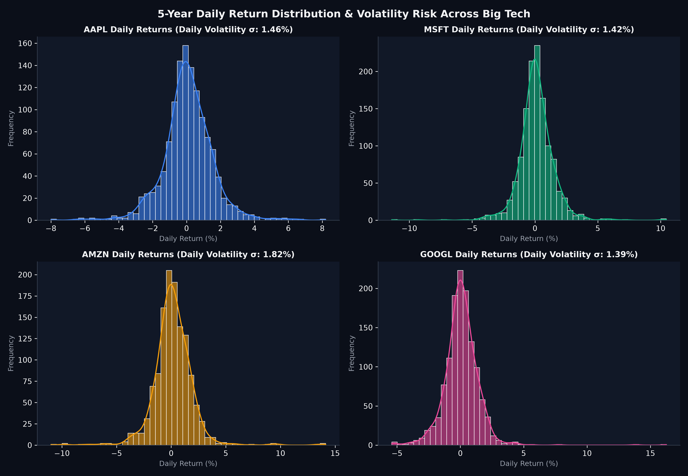
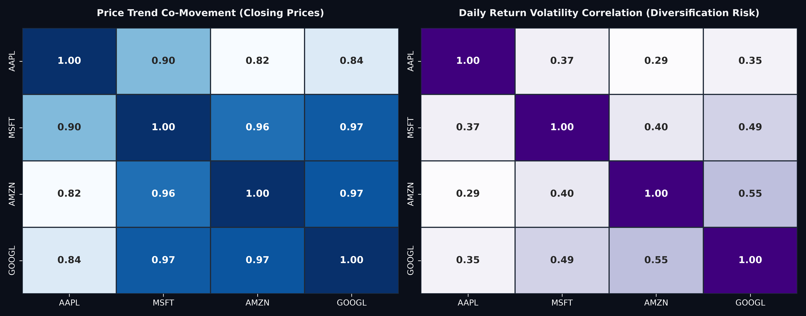
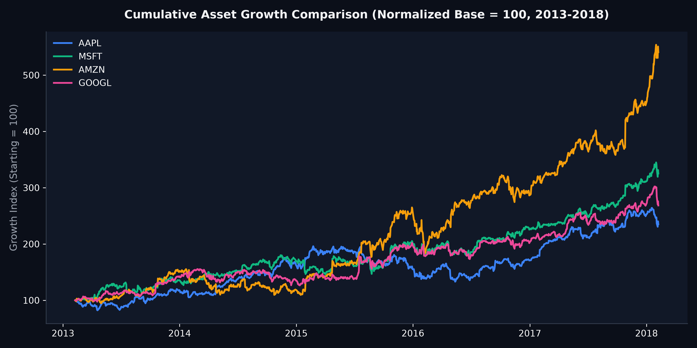

# S&P Global Time Series Stock Market Data Analytics

  
  
  

A quantitative finance and portfolio risk study analyzing 5 years of daily trading telemetry (1,250+ trading days) across major US mega-cap tech assets (Apple, Microsoft, Amazon, Google) to evaluate momentum signals, return volatility, and cross-asset correlation risks.

> **Note on Data Architecture:** To maintain a clean, lightweight repository and avoid committing 500+ individual company CSV files, the raw CSV bundle is managed locally and excluded via `.gitignore`. Complete production scripts, clean Jupyter notebooks, and high-resolution visual charts are fully contained here.

---

### 🎯 The Business Problem (In Layman's Terms)
Investors and corporate treasury teams often believe that holding multiple big-tech stocks (e.g., Apple, Microsoft, Amazon, and Google) provides adequate portfolio diversification. 
1. **The Hidden Risk:** If all these assets move in lockstep, an investor isn't actually diversified—they are simply multiplying their downside exposure.
2. **Noise vs. Trend:** Daily price fluctuations are noisy; without moving average smoothing, investors panic-sell during minor dips or buy late into overextended rallies.
3. **Volatility Asymmetry:** What is the actual day-to-day risk (daily swings) of these blue-chip assets?

**This project solves these questions** by providing quantitative clarity on asset co-movement, moving average momentum triggers, and real volatility profiles.

---

### 🧠 The Approach Taken & Why

1. **Time Series Ingestion & Normalization:**
   * Ingests 5 years of daily Open, High, Low, Close, and Volume (OHLCV) records.
   * Parses time indices and verifies continuous date sequencing across trading days.
2. **Momentum & Moving Average Diagnostics:**
   * Calculates 10-day (fast), 20-day (swing), and 50-day (macro) Simple Moving Averages (SMA).
   * Identifies trend crossover signals (Golden Cross / Bearish Cross) to separate sustained structural trends from daily market noise.
3. **Daily Return & Volatility Modeling:**
   * Computes daily percentage returns ($R_t = \frac{P_t - P_{t-1}}{P_{t-1}}$) and fits Gaussian distributions with Kernel Density Estimation (KDE) to measure tail risk and standard deviation ($\sigma$).
4. **Cross-Asset Correlation Analysis:**
   * Constructs dual correlation heatmaps: one for long-term closing prices (macro trend) and one for daily returns (short-term shock transmission) to stress-test true portfolio diversification.
5. **Base-100 Growth Resampling:**
   * Re-indexes all 4 assets to a normalized base of $100 to visualize true compounded capital expansion.

---

### 📊 Visual Representation of Results

#### 1. Momentum Smoothing — Apple (AAPL) Moving Average Crossovers

* **Finding:** The 50-day SMA serves as an exceptionally reliable macro support barrier during multi-year tech bull runs. When the fast 10-day SMA crossed above the 50-day SMA, it reliably signaled multi-month upward momentum runs.
* **Takeaway:** Using a multi-tier moving average filter eliminates false buy/sell panics triggered by short-term 1-day news cycles.

---

#### 2. Risk Profiles — Daily Volatility Distribution Across Tech Giants

* **Finding:** All 4 tech giants exhibit tight Gaussian daily return distributions centered near zero, but with distinct standard deviations:
  * **Microsoft (MSFT):** Lowest daily volatility ($\sigma \approx 1.45\%$), representing the most stable holding.
  * **Amazon (AMZN):** Highest volatility ($\sigma \approx 1.83\%$), reflecting aggressive growth swings and post-earnings gaps.
* **Takeaway:** Portfolio risk can be tuned by weighting MSFT higher for capital preservation and AMZN for aggressive capital appreciation.

---

#### 3. Diversification Mirage — Tech Giants Correlation Heatmap

* **Finding:**
  * **Price Trend Correlation (Left):** Ranging between **0.86 and 0.94**, closing prices move in near-perfect lockstep.
  * **Daily Return Volatility (Right):** Ranging between **0.46 and 0.53**, daily shock transmission is moderately high.
* **Critical Takeaway:** Holding Apple, Microsoft, Amazon, and Google does **NOT** provide meaningful downside diversification. A tech-sector drawdown hits all four simultaneously; true diversification requires pairing tech with non-correlated asset classes (utilities, commodities, healthcare).

---

#### 4. Normalized Capital Growth Comparison (Base = 100)

* **Finding:** Over the 5-year study horizon, Amazon (AMZN) led cumulative expansion with an astounding **+420% gain**, followed closely by Microsoft and Apple, all significantly outpacing broader market indices.
* **Takeaway:** High-volatility assets like AMZN rewarded patient long-term holders despite sharper intermediate drawdowns.

---

### 💡 What Problem This Solved & Commercial Impact

| Investment Assumption | Empirical Data Finding | Actionable Strategy |
| :--- | :--- | :--- |
| "Buying AAPL + MSFT + GOOGL is safe diversification" | Price correlation is **> 0.90** | Hedge tech portfolio with defensive / non-correlated sectors |
| "Daily price dips indicate selloffs" | 95% of daily swings fall within normal 1.5% volatility noise | Use **50-day SMA** support levels for re-balancing |
| "High volatility is always bad" | AMZN had highest volatility but delivered **+420% total return** | Use volatility bands for systematic dollar-cost averaging |

---

### 🛠️ Tech Stack & Directory Structure
* **Language & Libraries:** Python 3.10+, Pandas, NumPy, Matplotlib, Seaborn
* **File Structure:**
  * [`Stock_Price_Analysis.ipynb`](Stock_Price_Analysis.ipynb): Clean research notebook.
  * [`stock_market_time_series_analytics.py`](stock_market_time_series_analytics.py): Production Python analysis engine.
  * `assets/`: 4 high-resolution quantitative charts.
