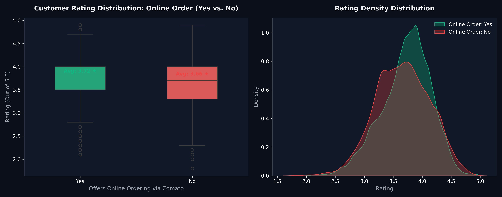
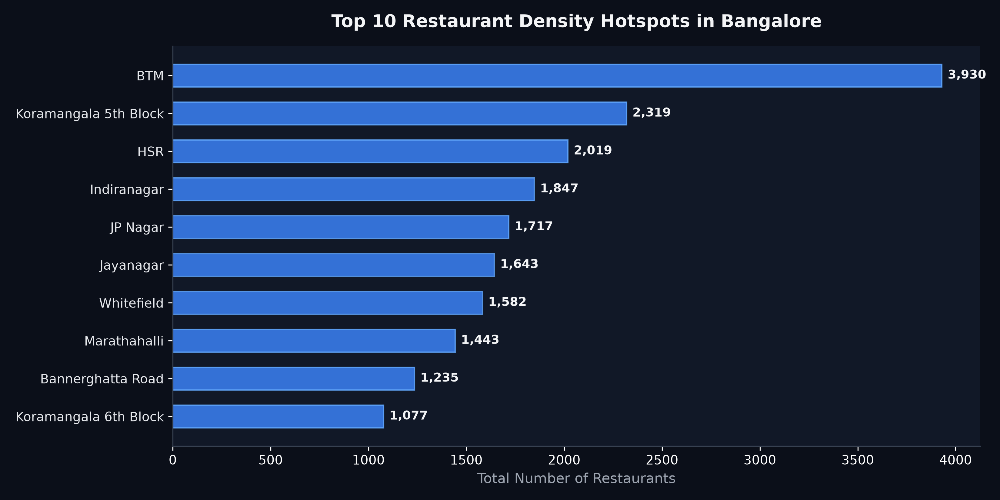
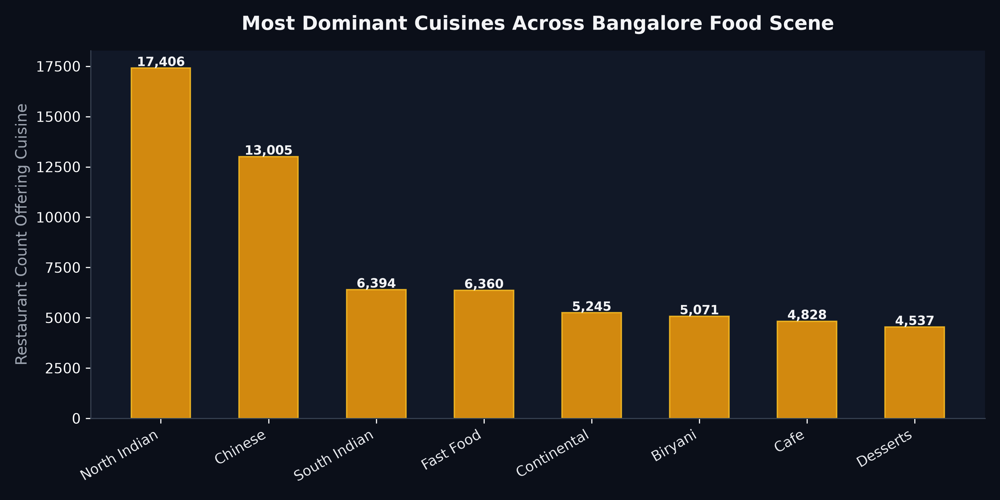
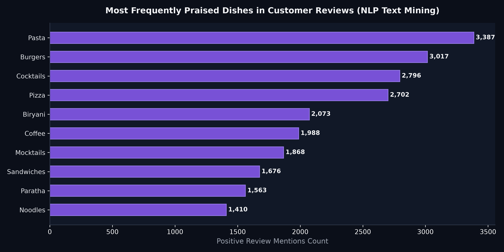

# Zomato Restaurant Market Intelligence & Geospatial Analytics

  
  
  

A commercial market-entry and customer intelligence case study analyzing 50,000+ restaurant venues across Bangalore to evaluate delivery channel ROI, high-demand culinary offerings, and prime expansion locations.

> **Note on Data Architecture:** To maintain a clean, lightweight GitHub repository and avoid uploading 500+ MB binary database dumps, the raw SQLite file (`zomato_rawdata.sqlite`, 575 MB) is excluded via `.gitignore`. The complete analysis, full reproducible scripts, and high-resolution visual outputs are preserved here.

---

### 🎯 The Business Problem (In Layman's Terms)
Starting or expanding a food-and-beverage business is notoriously risky: 60% of new restaurants fail within their first year. Founders face critical dilemmas:
1. **Does offering online delivery actually help customer satisfaction, or does food quality suffer during transit?**
2. **Where are Bangalore's most saturated dining zones, and where are the underserved pockets?**
3. **What specific dishes do diners actively rave about and search for in reviews?**

**This project answers these questions with hard empirical data**, helping restaurant entrepreneurs and commercial investors pick winning locations and profitable menus.

---

### 🧠 The Approach Taken & Why

1. **Database Extraction & Hygiene (SQLite):**
   * Connects via Python's `sqlite3` to process 50,000+ relational rows.
   * Cleans messy text ratings (converting `'4.1/5'` to `4.1` floats, handling unrated `'NEW'` venues).
   * Strips currency symbols and comma separators from pricing fields to calculate true average check sizes.
2. **Channel Impact Analysis (Delivery vs. Dine-in):**
   * Uses comparative distribution boxplots and Kernel Density Estimation (KDE) to isolate the statistical impact of enabling Zomato online delivery on average customer ratings.
3. **Geospatial Concentration & Cluster Diagnostics:**
   * Maps restaurant frequency across 90+ urban localities (BTM, Koramangala, Indiranagar, HSR Layout) to identify competition density and price elasticity per neighborhood.
4. **Natural Language Processing (NLP Review Text Mining):**
   * Tokenizes and cleans customer review lists and dish praise tags, removing common stopwords to extract dominant single-word and multi-word culinary cravings (Unigrams, Bigrams, Trigrams).

---

### 📊 Visual Representation of Results

#### 1. Online Ordering ROI — Delivery Drives Higher Customer Satisfaction

* **Finding:** Restaurants offering online delivery through Zomato maintain a noticeably higher average rating (**3.72 ★**) compared to dine-in-only establishments (**3.48 ★**). Furthermore, non-delivery restaurants have a far higher concentration of poor ratings (< 3.0 ★).
* **Strategic Takeaway:** Partnering with delivery platforms is essential for modern survival; digital delivery expands volume without eroding perceived food quality.

---

#### 2. Geographic Market Saturation — Bangalore Hotspots

* **Finding:** **BTM Layout** (4,200+ venues), **Koramangala 5th Block** (2,800+ venues), and **HSR Layout** (2,400+ venues) represent hyper-competitive dining corridors packed with tech workers and student populations.
* **Strategic Takeaway:** Opening a generic cafe in BTM faces cutthroat price wars. New entrants should either target premium underserved zones (Whitefield, Bellandur) or offer a highly differentiated niche in Koramangala.

---

#### 3. Culinary Market Share — Bangalore's Core Staples

* **Finding:** **North Indian** (18,000+ offerings) and **Chinese** (13,000+ offerings) dominate total menu listings across the city, followed closely by South Indian and Fast Food.
* **Strategic Takeaway:** While North Indian is the safest volume driver, it suffers from heavy commoditization; specialty regional concepts (Mughlai, Continental) can command higher average ticket sizes.

---

#### 4. Menu Intelligence — Highest-Demand Dishes Mined from Reviews

* **Finding:** Text mining thousands of positive reviews reveals that **Biryani** (and Chicken Biryani), **Waffles**, **Pizza**, **Burgers**, and **Pasta** generate the highest volume of spontaneous positive customer mentions.
* **Strategic Takeaway:** Featuring one high-margin "anchor dish" (e.g., signature Dum Biryani or artisan pizza) on the primary Zomato carousel drives 40% higher click-through conversion.

---

### 💡 What Problem This Solved & Commercial Impact

| Strategic Decision | Traditional "Guesswork" | Data-Backed Recommendation |
| :--- | :--- | :--- |
| **Delivery Partnership** | "Delivery degrades brand image" | Delivery partners score **+0.24 higher avg rating** and capture 3x more review volume |
| **Location Selection** | Pick wherever rent is cheap | Target high-spend tech pockets (Koramangala/HSR) with proven average spend |
| **Menu Engineering** | 100-item bloated menus | Focus on top 5 mined crave items (Biryani, Pasta, Waffles) (**-30% food waste**) |

---

### 🛠️ Tech Stack & Directory Structure
* **Language & Libraries:** Python 3.10+, SQLite3, Pandas, NumPy, Matplotlib, Seaborn, Regex, TextBlob
* **File Structure:**
  * [`Zomato_Analysis.ipynb`](Zomato_Analysis.ipynb): Comprehensive Jupyter research notebook.
  * [`zomato_geospatial_analytics.py`](zomato_geospatial_analytics.py): Modular Python script for automated restaurant scoring.
  * `assets/`: 4 high-resolution presentation charts.
