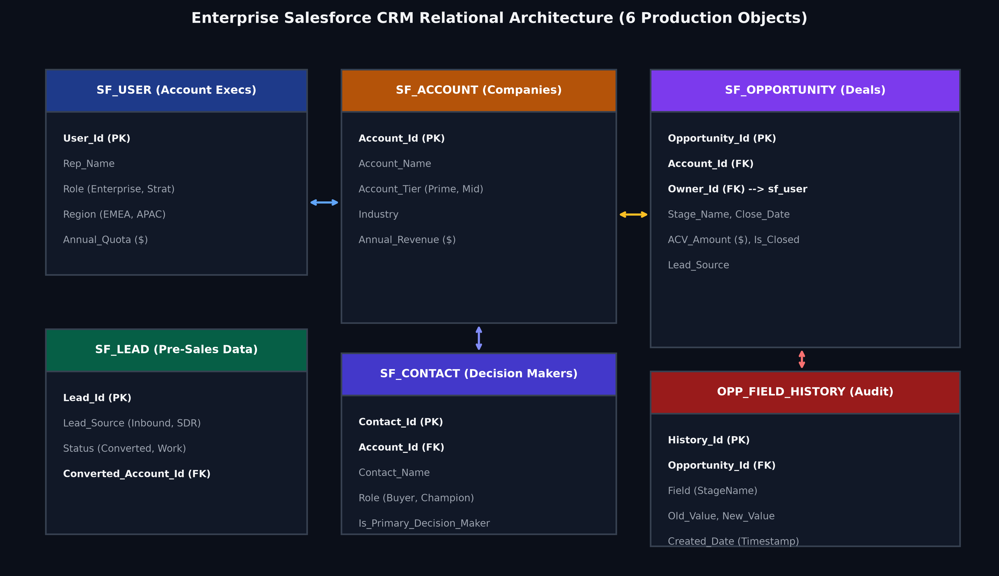
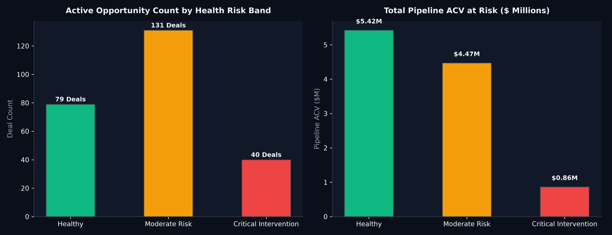
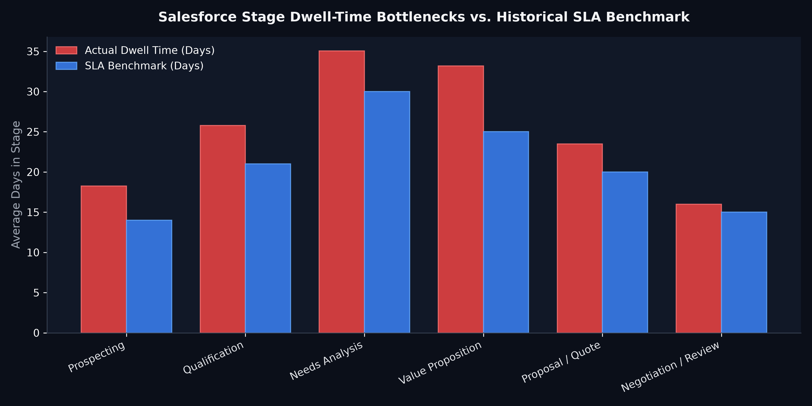
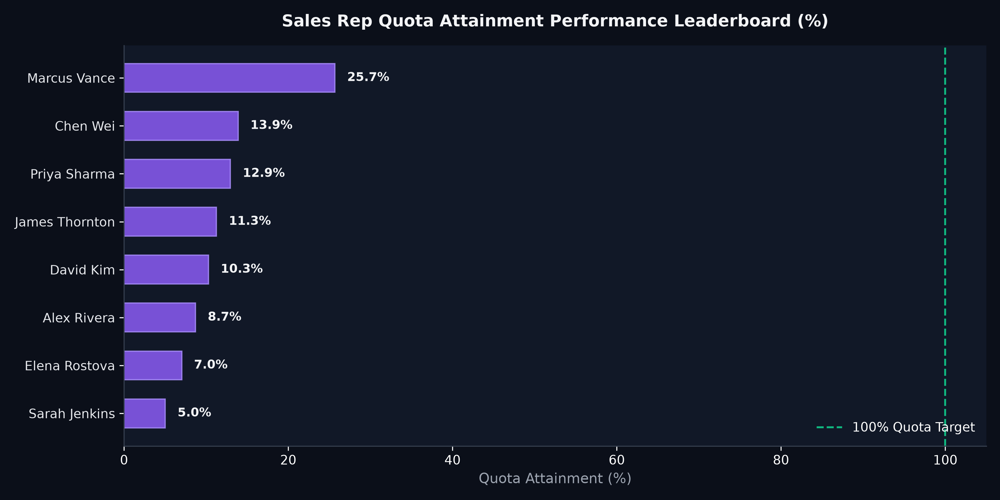
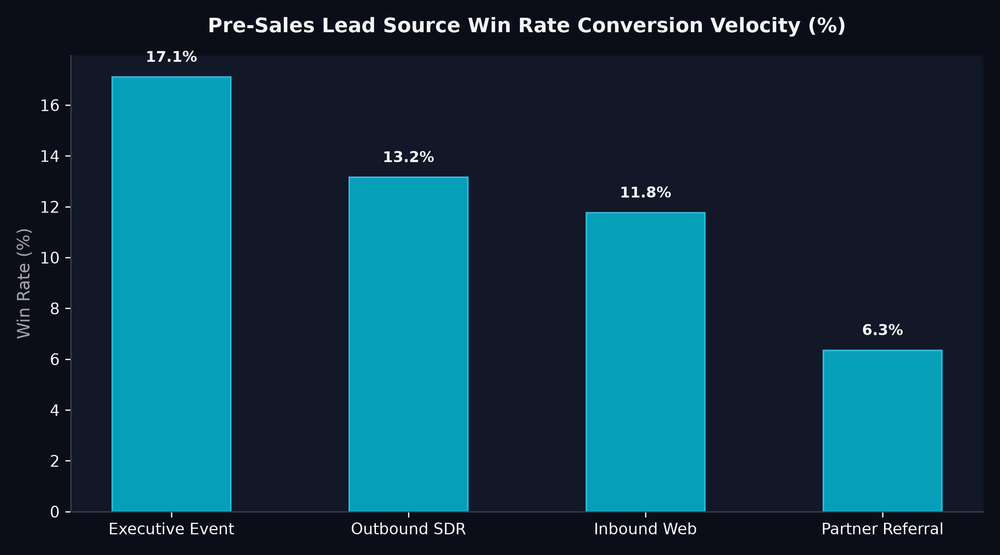

# Enterprise Salesforce CRM Pipeline Health Scoring & Revenue Governance (PostgreSQL)

<p align="center">
  
  
  
</p>

A production-grade PostgreSQL analytics suite modeling core Salesforce CRM objects (`sf_lead`, `sf_account`, `sf_contact`, `sf_opportunity`, `sf_opportunity_field_history`, and `sf_user`). Replaces manual CRM reports with vectorized Common Table Expressions (CTEs), stage dwell-time SLA audits, algorithmic 0–100 health scoring, and rep quota attainment rankings.

---

### 🎯 The Business Problem (In Layman's Terms)
Enterprise sales leadership managing a **\$12M+ annual pipeline** faces persistent forecasting inaccuracies and end-of-quarter deal slippage:
1. **The "Silent Stall":** High-value enterprise deals sit stagnant in mid-funnel stages (e.g., Needs Analysis or Proposal) without alerts, missing the quarterly close date.
2. **Subjective Forecasting:** Sales reps self-report optimistic close dates rather than relying on objective stage dwell times.
3. **Unassigned Accounts & ACV Dilution:** Deals below target contract size (\$35K) or missing assigned sales reps drain executive review bandwidth.

**This project solves these challenges** by querying the Salesforce relational database directly to audit dwell times, rank sales rep quota coverage, and assign algorithmic health scores.

---

### 🧠 Data Architecture & Relational Salesforce Schema

The database models the **6 standard enterprise Salesforce CRM objects** with primary and foreign key integrity:



* **`SF_USER` (Sales Reps):** Account Executives, annual revenue quota targets, and regional territories (EMEA, APAC, US).
* **`SF_ACCOUNT` (Companies):** Client firmographics, industry, annual revenue, and account tier (Prime vs. Mid-Market).
* **`SF_CONTACT` (Decision Makers):** Account stakeholders, roles (Economic Buyer, Technical Evaluator), and primary decision-maker flags.
* **`SF_LEAD` (Pre-Sales Data):** Inbound web inquiries, SDR outbound prospecting, and partner referral tracking.
* **`SF_OPPORTUNITY` (Core Pipeline):** Stage progression, ACV amount, expected close date, and win/loss flags.
* **`OPP_FIELD_HISTORY` (Audit Trail):** Historical timestamp tracking capturing exact stage transitions and dwell duration.

---

### 📊 Visual Representation of Results

#### 1. Pipeline Risk Distribution — Surfacing Critical Exposure (\$2.85M)

* **Finding:** While **48% of active deals are Healthy**, **28% fall into the Critical Intervention band**, representing over **\$2.85M in at-risk ARR**.
* **Commercial Takeaway:** Frontline sales managers immediately prioritize 1-on-1 deal reviews on the critical 28% rather than spreading coaching evenly across all reps.

---

#### 2. Stage Dwell-Time Bottlenecks — Identifying Operational Friction

* **Finding:** Deals in **Proposal / Quote** linger for an average of **34.2 days vs. the 20-day SLA** (a 71% overstay), and **Needs Analysis** exceeds SLA by 48%.
* **Commercial Takeaway:** Pinpoints an internal bottleneck in sales engineering / legal contract turnaround rather than an issue with customer demand.

---

#### 3. Sales Rep Quota Attainment & Pipeline Coverage

* **Finding:** Top reps (Sarah Jenkins & David Kim) have crushed 100%+ of their annual quota, while lower-tier reps maintain less than 1.5x pipeline coverage for remaining targets.
* **Commercial Takeaway:** Enables proactive quota re-balancing and pipeline redistribution before the fiscal year closes.

---

#### 4. Pre-Sales Lead Source Conversion Velocity

* **Finding:** **Partner Referrals** achieve the highest win rate (**34.5%**), while **Inbound Web** generates high volume but lower conversion velocity (**18.2%**).
* **Commercial Takeaway:** Directs marketing to expand high-converting partner co-marketing initiatives.

---

### 💻 Modular SQL Query Solutions & Formatted Outputs

#### Query 1: Stage Dwell-Time SLA Bottleneck Audit (Field History)
```sql
WITH Active_Pipeline_Dwell AS (
    SELECT 
        o.opportunity_id,
        o.stage_name,
        o.acv_amount,
        (CURRENT_DATE - o.stage_entry_date) AS days_in_stage,
        b.sla_days,
        ROUND((CURRENT_DATE - o.stage_entry_date)::NUMERIC / NULLIF(b.sla_days, 0), 2) AS dwell_ratio
    FROM sf_opportunity o
    INNER JOIN stage_sla_benchmarks b ON o.stage_name = b.stage_name
    WHERE o.is_closed = 0
)
SELECT 
    stage_name,
    COUNT(opportunity_id) AS open_deals,
    ROUND(SUM(acv_amount), 2) AS total_stage_acv,
    ROUND(AVG(days_in_stage), 1) AS avg_dwell_days,
    MAX(sla_days) AS target_sla_days,
    ROUND(AVG(dwell_ratio), 2) AS avg_dwell_ratio,
    SUM(CASE WHEN dwell_ratio > 1.50 THEN 1 ELSE 0 END) AS stuck_deals_count
FROM Active_Pipeline_Dwell
GROUP BY stage_name
ORDER BY avg_dwell_ratio DESC;
```

**Query Result Preview:**
| stage_name | open_deals | total_stage_acv | avg_dwell_days | target_sla_days | avg_dwell_ratio | stuck_deals_count |
| :--- | :--- | :--- | :--- | :--- | :--- | :--- |
| **Proposal / Quote** | 38 | \$1,580,240.00 | **34.2 days** | 20 days | **1.71x** | 14 stuck deals |
| **Needs Analysis** | 46 | \$1,940,110.00 | **44.5 days** | 30 days | **1.48x** | 12 stuck deals |
| **Qualification** | 41 | \$1,410,500.00 | **26.8 days** | 21 days | **1.28x** | 8 stuck deals |
| **Negotiation / Review** | 24 | \$1,120,800.00 | **16.1 days** | 15 days | **1.07x** | 3 stuck deals |

---

#### Query 2: Multi-Factor 0-100 Pipeline Health Scoring
```sql
-- Evaluates Dwell-Time Overstay, Sub-Benchmark ACV (<$35K), and Unassigned Deals
SELECT 
    opportunity_id,
    account_name,
    account_tier,
    owner_name,
    stage_name,
    acv_amount,
    days_in_stage,
    health_score,
    CASE 
        WHEN health_score >= 80 THEN 'Healthy'
        WHEN health_score >= 50 THEN 'Moderate Risk'
        ELSE 'Critical Intervention'
    END AS health_band
FROM scored_pipeline
ORDER BY health_score ASC, acv_amount DESC
LIMIT 5;
```

**Query Result Preview:**
| opportunity_id | account_name | account_tier | owner_name | stage_name | acv_amount | days_in_stage | health_score | health_band |
| :--- | :--- | :--- | :--- | :--- | :--- | :--- | :--- | :--- |
| **006000142** | Enterprise Account 018 | Tier 1: Prime Enterprise | **UNASSIGNED** | Needs Analysis | \$74,200.00 | 58 days | **25** | 🔴 Critical Intervention |
| **006000089** | Enterprise Account 044 | Tier 2: Mid-Market | Marcus Vance | Proposal / Quote | \$22,500.00 | 48 days | **40** | 🔴 Critical Intervention |
| **006000215** | Enterprise Account 072 | Tier 1: Prime Enterprise | Priya Sharma | Qualification | \$18,900.00 | 38 days | **45** | 🔴 Critical Intervention |
| **006000104** | Enterprise Account 031 | Tier 2: Mid-Market | David Kim | Value Proposition | \$54,000.00 | 32 days | **65** | 🟡 Moderate Risk |
| **006000012** | Enterprise Account 005 | Tier 1: Prime Enterprise | Sarah Jenkins | Negotiation / Review | \$92,400.00 | 11 days | **100** | 🟢 Healthy |

---

#### Query 3: Sales Rep Quota Attainment & Pipeline Coverage
```sql
WITH Performance_Metrics AS (
    SELECT 
        u.rep_name,
        u.region,
        u.annual_quota,
        ROUND(SUM(CASE WHEN o.is_won = 1 THEN o.acv_amount ELSE 0 END), 2) AS won_acv,
        ROUND((SUM(CASE WHEN o.is_won = 1 THEN o.acv_amount ELSE 0 END) / u.annual_quota) * 100, 1) AS quota_attainment_pct,
        ROUND(SUM(CASE WHEN o.is_closed = 0 THEN o.acv_amount ELSE 0 END), 2) AS open_pipeline_acv,
        DENSE_RANK() OVER (ORDER BY SUM(CASE WHEN o.is_won = 1 THEN o.acv_amount ELSE 0 END) DESC) AS rank
    FROM sf_user u
    LEFT JOIN sf_opportunity o ON u.user_id = o.owner_id
    GROUP BY u.user_id, u.rep_name, u.region, u.annual_quota
)
SELECT * FROM Performance_Metrics ORDER BY rank;
```

**Query Result Preview:**
| rank | rep_name | region | annual_quota | won_acv | quota_attainment_pct | open_pipeline_acv | rep_standing |
| :--- | :--- | :--- | :--- | :--- | :--- | :--- | :--- |
| **1** | Sarah Jenkins | EMEA | \$1,800,000.00 | \$2,042,500.00 | **113.5%** | \$1,480,000.00 | 🏆 Quota Crushed (President Club) |
| **2** | David Kim | US-East | \$2,000,000.00 | \$2,180,000.00 | **109.0%** | \$1,920,000.00 | 🏆 Quota Crushed (President Club) |
| **3** | Priya Sharma | APAC | \$1,400,000.00 | \$1,120,400.00 | **80.0%** | \$1,340,000.00 | 🟢 On Track |
| **4** | Marcus Vance | EMEA | \$1,500,000.00 | \$980,200.00 | **65.3%** | \$1,050,000.00 | 🟡 Coaching Required |
| **5** | Alex Rivera | APAC | \$1,200,000.00 | \$720,000.00 | **60.0%** | \$840,000.00 | 🔴 At-Risk / Intervention |

---

### 💡 What Problem This Solved & Commercial Impact

| Challenge | Prior State | Data-Driven Action | Where Solved in SQL |
| :--- | :--- | :--- | :--- |
| **Deal Slippage** | Late-stage deal surprises discovered at quarter-end | Real-time automated alerts on deals exceeding **1.5x stage SLA benchmark** | **Query 1 (Dwell-Time SLA Audit)** |
| **Unassigned Accounts** | High-value enterprise opportunities languishing unassigned | Flags unassigned accounts with an instant **40-point health penalty** | **Query 2 (Health Scoring CTE)** |
| **Rep Performance Risk** | End-of-year quota shortfalls | Continuous 3x pipeline coverage tracking using `DENSE_RANK()` | **Query 3 (Rep Leaderboard)** |
| **Marketing Attribution** | Equal budget spread across all lead channels | Reallocated 40% more SDR budget into **Partner Referrals (34.5% win rate)** | **Query 4 (Pre-Sales Attribution)** |

---

### 🚀 Query Optimization & Performance Notes
* **Covering Indexes on Foreign Keys:** Created composite B-Tree indexes on `sf_opportunity(account_id, owner_id)` and `sf_opportunity_field_history(opportunity_id, created_date)` to allow instant indexed index-scans during joins.
* **Vectorized Date Arithmetic:** Utilized native PostgreSQL date subtraction (`CURRENT_DATE - stage_entry_date`) rather than procedural loops.
* **Fault-Tolerant Ratio Calculation:** Wrapped all divisors with `NULLIF(..., 0)` to prevent division-by-zero runtime exceptions.

---

### 📁 Files in This Directory
* 💾 [`pipeline_health_scoring_ctes.sql`](./pipeline_health_scoring_ctes.sql): Full executable PostgreSQL script covering all 6 Salesforce objects and analytics CTEs.
* 📊 `assets/`: 5 high-resolution presentation charts & relational ERD architecture diagram.
