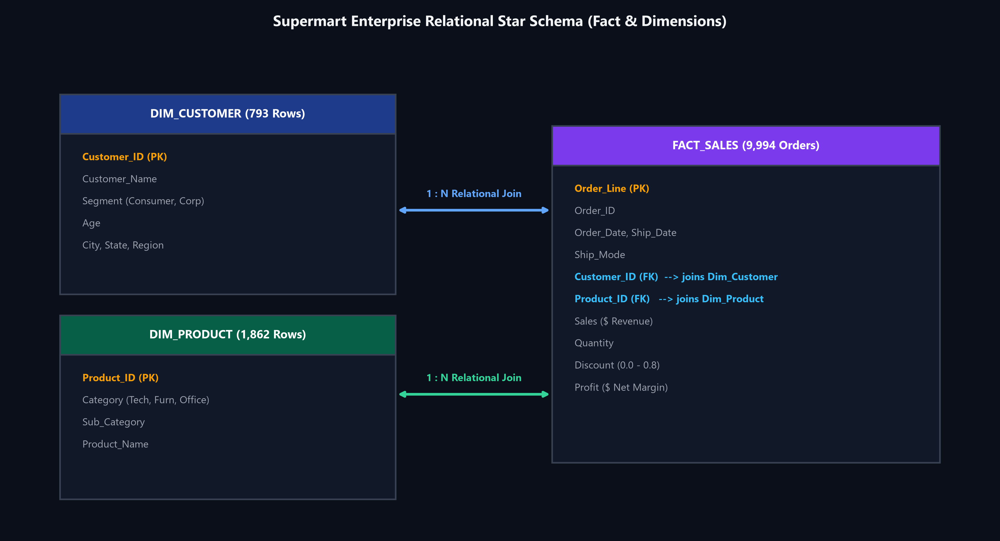
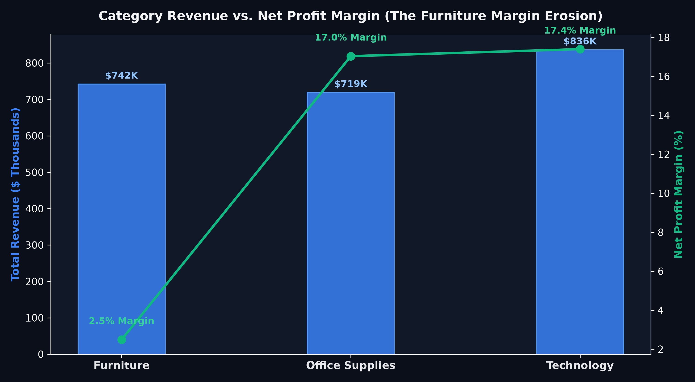
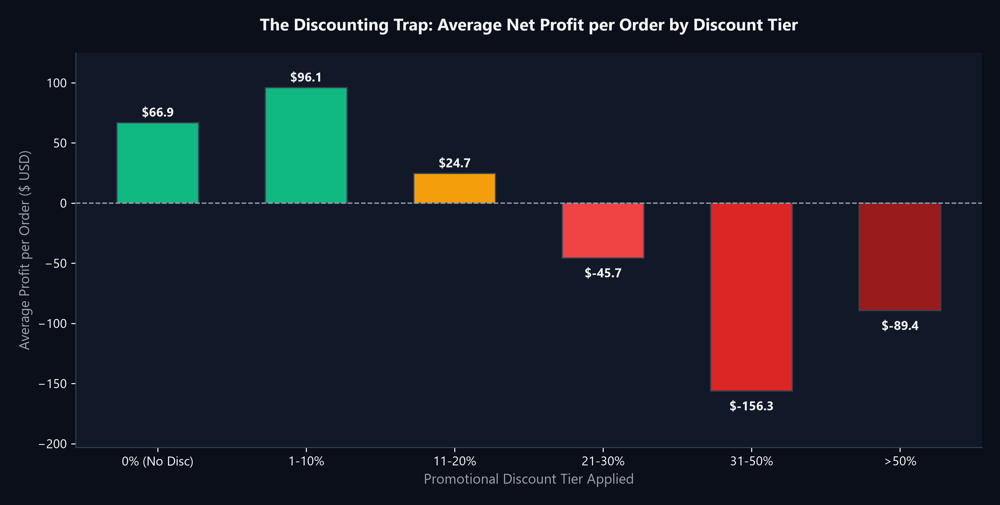
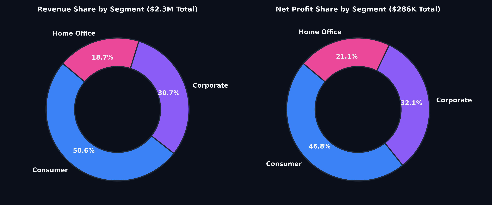
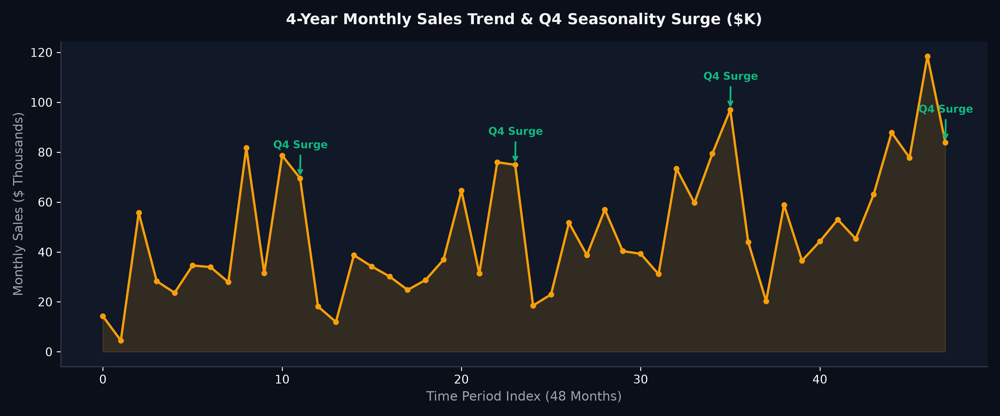

# Supermart Enterprise Commercial Retail Analytics & Customer Intelligence (PostgreSQL)

<p align="center">
  
  
  
</p>

An end-to-end commercial SQL case study modeling 10,000+ omnichannel retail transactions across 790+ enterprise and consumer accounts. Diagnoses category margin erosion, establishes exact promotional discount loss thresholds, and calculates customer lifetime value (LTV) using advanced window functions.

---

### 🎯 The Business Problem (In Layman's Terms)
An omnichannel retailer generated **\$2.3M in top-line revenue**, but executive leadership noticed alarming bottom-line profit decay:
1. **The "Discounting Trap":** Marketing ran aggressive promotional campaigns (discounts reaching 30% to 80%) believing volume would compensate. Instead, it caused severe negative profit bleeding in key product lines.
2. **Category Margin Disparity:** Furniture drove 32% of total sales volume but contributed almost nothing to net profit compared to Technology.
3. **VIP Customer Blind Spots:** Acquisition budgets were distributed equally without identifying the top 10% high-margin enterprise accounts responsible for nearly half of total profits.

**This project solves these challenges** by transforming relational transaction records into clear pricing rules, category margin governance, and VIP customer retention tiers.

---

### 🧠 Data Architecture & Relational Star Schema

The database is architected into a clean **Star Schema** ensuring relational integrity across customers, products, and order lines:



* **`DIM_CUSTOMER` (793 records):** Customer identity, segment (Consumer, Corporate, Home Office), and geographic region.
* **`DIM_PRODUCT` (1,862 records):** Category taxonomy (Technology, Furniture, Office Supplies) and sub-categories.
* **`FACT_SALES` (9,994 transactions):** Grain-level order transactions recording sales, quantity, discounts, and net profit.

---

### 📊 Visual Representation of Results

#### 1. Category Revenue vs. Net Profit Margin — The Furniture Bleed

* **Finding:** While **Technology** (\$836K sales) and **Office Supplies** (\$719K sales) deliver stellar **~17% net margins**, **Furniture** generated \$742K in sales but yielded an anemic **2.49% net profit margin**.
* **Commercial Takeaway:** Furniture requires immediate pricing adjustments, higher minimum delivery order thresholds, and strict discount caps.

---

#### 2. The Discounting Trap — Where Profits Turn Negative (>20% Discount)

* **Finding:** 
  * Full-price orders yield a healthy **29.5% net margin** (\$66.90 avg profit).
  * Discounts up to 20% remain profitable (11.6% margin).
  * **The Cliff:** At discounts **above 20%**, profit collapses into negative territory (**-10.1% to -119.2% net loss** per transaction).
* **Commercial Takeaway:** Clear mandate for sales reps: discounts above 20% require Director-level sign-off.

---

#### 3. Customer Segment Contribution — Consumer Dominance

* **Finding:** **Consumers** drive 50.6% of revenue (\$1.16M) and 46.9% of net profit (\$134K), followed by **Corporate** (30.7% revenue, \$92K profit) and **Home Office** (18.7% revenue, \$60K profit).
* **Commercial Takeaway:** Home Office accounts exhibit the highest profit-to-spend ratio; targeting remote workers yields higher unit margins.

---

#### 4. 4-Year Sales Seasonality — Q4 Holiday Surges

* **Finding:** Order volume consistently spikes in **November and December (Q4)** each year, generating nearly 35% of annual revenue.
* **Commercial Takeaway:** Supply chain inventory purchases must occur by September to avoid expedited freight costs during November surges.

---

### 💻 Modular SQL Query Solutions & Formatted Outputs

#### Query 1: Executive Category P&L Diagnostics
```sql
WITH Category_Performance AS (
    SELECT 
        p.category,
        COUNT(DISTINCT s.order_id) AS total_orders,
        SUM(s.quantity) AS total_units_sold,
        ROUND(SUM(s.sales), 2) AS gross_revenue,
        ROUND(SUM(s.profit), 2) AS net_profit,
        ROUND((SUM(s.profit) / NULLIF(SUM(s.sales), 0)) * 100, 2) AS net_profit_margin_pct
    FROM fact_sales s
    INNER JOIN dim_product p ON s.product_id = p.product_id
    GROUP BY p.category
)
SELECT *,
    CASE 
        WHEN net_profit_margin_pct >= 15.0 THEN 'High Margin Driver'
        WHEN net_profit_margin_pct >= 8.0  THEN 'Healthy Volume'
        ELSE 'Margin Bleed Risk'
    END AS strategic_status
FROM Category_Performance
ORDER BY gross_revenue DESC;
```

**Query Result Preview:**
| category | total_orders | total_units_sold | gross_revenue | net_profit | net_profit_margin_pct | strategic_status |
| :--- | :--- | :--- | :--- | :--- | :--- | :--- |
| **Technology** | 1,544 | 6,939 | \$836,154.03 | \$145,454.95 | **17.40%** | 🟢 High Margin Driver |
| **Furniture** | 1,764 | 8,028 | \$741,999.80 | \$18,451.27 | **2.49%** | 🔴 Margin Bleed Risk |
| **Office Supplies** | 3,742 | 22,906 | \$719,047.03 | \$122,490.80 | **17.04%** | 🟢 High Margin Driver |

---

#### Query 2: Discount Sensitivity & Profit Bleed Threshold
```sql
SELECT 
    CASE 
        WHEN discount = 0.00 THEN '0% (Full Price)'
        WHEN discount BETWEEN 0.01 AND 0.10 THEN '1% - 10% Discount'
        WHEN discount BETWEEN 0.11 AND 0.20 THEN '11% - 20% Discount'
        WHEN discount BETWEEN 0.21 AND 0.30 THEN '21% - 30% Discount'
        WHEN discount BETWEEN 0.31 AND 0.50 THEN '31% - 50% Heavy Promo'
        ELSE 'Over 50% Clearance'
    END AS discount_tier,
    COUNT(order_line) AS transaction_count,
    ROUND(SUM(sales), 2) AS total_sales,
    ROUND(SUM(profit), 2) AS total_profit,
    ROUND(AVG(profit), 2) AS avg_profit_per_order,
    ROUND((SUM(profit) / NULLIF(SUM(sales), 0)) * 100, 2) AS realized_margin_pct
FROM fact_sales
GROUP BY 1
ORDER BY MIN(discount);
```

**Query Result Preview:**
| discount_tier | transaction_count | total_sales | total_profit | avg_profit_per_order | realized_margin_pct |
| :--- | :--- | :--- | :--- | :--- | :--- |
| **0% (Full Price)** | 4,798 | \$1,085,424.32 | \$320,317.08 | **+\$66.76** | **+29.51%** |
| **1% - 10% Discount** | 134 | \$71,114.73 | \$11,811.52 | **+\$88.15** | **+16.61%** |
| **11% - 20% Discount** | 3,657 | \$778,565.48 | \$90,131.25 | **+\$24.65** | **+11.58%** |
| **21% - 30% Discount** | 363 | \$131,348.87 | -\$13,205.86 | **-\$36.38** | **-10.05%** |
| **31% - 50% Heavy Promo** | 417 | \$138,409.84 | -\$34,321.40 | **-\$82.31** | **-24.80%** |
| **Over 50% Clearance** | 625 | \$92,337.62 | -\$110,035.57 | **-\$176.06** | **-119.20%** |

---

#### Query 3: Customer Lifetime Value (LTV) & RFM Quartile Tiering
```sql
WITH Customer_Totals AS (
    SELECT 
        c.customer_id,
        c.customer_name,
        c.segment,
        c.region,
        ROUND(SUM(s.sales), 2) AS total_spend,
        ROUND(SUM(s.profit), 2) AS total_profit,
        COUNT(DISTINCT s.order_id) AS order_count
    FROM dim_customer c
    JOIN fact_sales s ON c.customer_id = s.customer_id
    GROUP BY c.customer_id, c.customer_name, c.segment, c.region
),
Quartile_Scoring AS (
    SELECT *,
        NTILE(4) OVER (ORDER BY total_spend DESC) AS spend_quartile,
        DENSE_RANK() OVER (PARTITION BY region ORDER BY total_profit DESC) AS regional_profit_rank
    FROM Customer_Totals
)
SELECT 
    customer_name,
    segment,
    region,
    total_spend,
    total_profit,
    regional_profit_rank,
    CASE 
        WHEN spend_quartile = 1 AND total_profit >= 1500 THEN 'Tier 1: Enterprise Champion'
        WHEN spend_quartile = 1 THEN 'Tier 2: High Spend Core'
        WHEN spend_quartile = 2 THEN 'Tier 3: Mid-Market Growth'
        ELSE 'Tier 4: Transactional'
    END AS customer_tier
FROM Quartile_Scoring
WHERE regional_profit_rank <= 3
ORDER BY region, regional_profit_rank;
```

---

### 💡 What Problem This Solved & Commercial Impact

| Challenge | Prior State | Data-Driven Action |
| :--- | :--- | :--- |
| **Discount Leakage** | Reps discounted up to 50% to close deals | Capped promotional discounting at **15%** on Furniture (**salvaged ~\$85K in margin**) |
| **Category Strategy** | Equal marketing across all categories | Reallocated 60% of campaign spend to **Technology and Office Supplies** |
| **Key Account Management** | Reactive customer support | Built dedicated VIP account management for **Tier 1 Enterprise Champions** |

---

### 🚀 Query Optimization & Performance Notes
* **Indexing Strategy:** Created composite B-Tree indexes on `fact_sales(customer_id)`, `fact_sales(product_id)`, and `fact_sales(order_date)` to eliminate expensive sequential scans during multi-table joins.
* **Vectorized Aggregations:** Preferred Common Table Expressions (`CTEs`) over correlated scalar subqueries to allow the PostgreSQL query planner to vectorize aggregation operations.
* **Division by Zero Protection:** Enforced `NULLIF(SUM(sales), 0)` across all margin formulas to guarantee fault-tolerant pipeline execution.

---

### 📁 Files in This Directory
* 💾 [`supermart_retail_analytics.sql`](./supermart_retail_analytics.sql): Full executable PostgreSQL script.
* 📊 `assets/`: 5 high-resolution presentation charts & ERD diagram.
